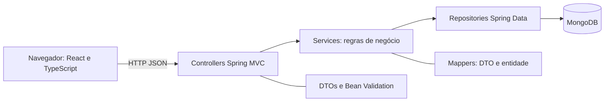
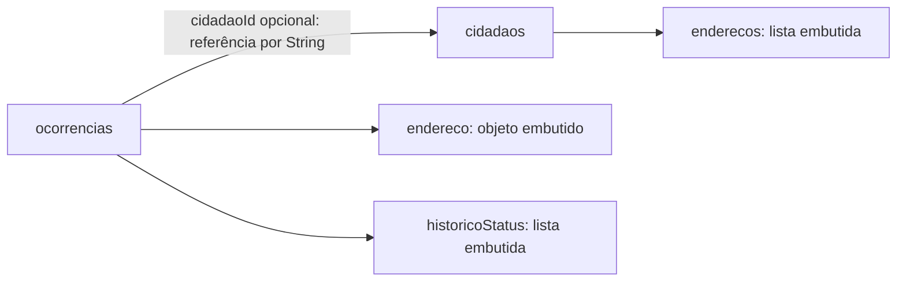

# Documentação técnica — ObservAção

## Objetivo e arquitetura

O ObservAção permite registrar problemas urbanos e acompanhar seu atendimento. O frontend React apresenta telas públicas de cidadão, atendente e gestor. A API também permite cadastrar cidadãos com endereços, vincular ocorrências e consultar o histórico de status. Essas operações adicionais não possuem telas próprias.



Tecnologias declaradas: Java 17, Spring Boot 3.2.5, Spring Data MongoDB, Jakarta Validation e Lombok; React 18, TypeScript, Vite 5 e TailwindCSS; MongoDB 7 no Compose; JUnit 5, MockMvc e JaCoCo 0.8.12. O Dockerfile do frontend usa Node.js 20 e executa o servidor de desenvolvimento Vite. Não há autenticação nem autorização por perfil; os nomes das telas não restringem acesso.

## Modelagem



Um cidadão pode ser referenciado por várias ocorrências. Cada ocorrência tem, no máximo, um `cidadaoId`. A referência é validada pela aplicação, não por chave estrangeira no banco. Não existe exclusão em cascata nem bloqueio da exclusão de cidadão vinculado; a remoção pode deixar referências sem documento correspondente.

Exemplo de cidadão, com `_id` representando o identificador persistido:

```json
{
  "_id": "cid-exemplo",
  "nome": "Ana Exemplo",
  "email": "ana@example.com",
  "enderecos": [
    { "rua": "Rua das Flores", "numero": "120", "bairro": "Centro", "cidade": "Maringá", "estado": "PR" }
  ]
}
```

Exemplo de ocorrência em Extended JSON, com datas BSON:

```json
{
  "_id": "ocr-exemplo",
  "titulo": "Buraco na via",
  "descricao": "Buraco próximo ao número 120.",
  "categoria": "INFRAESTRUTURA",
  "endereco": { "rua": "Rua das Flores", "numero": "120", "bairro": "Centro" },
  "prioridade": "ALTA",
  "status": "EM_ANALISE",
  "cidadaoId": "cid-exemplo",
  "historicoStatus": [
    { "status": "EM_ANALISE", "data": { "$date": "2026-11-10T12:00:00Z" } }
  ],
  "created_at": { "$date": "2026-11-10T11:00:00Z" },
  "updated_at": { "$date": "2026-11-10T12:00:00Z" }
}
```

O backend gera UUIDs em String para novos registros. Documentos de exemplo de ocorrências podem usar ObjectId gerado pelo MongoDB. A API expõe `id`, `createdAt` e `updatedAt`; datas são strings ISO 8601 nas respostas. `MongoConfig` converte `OffsetDateTime` em BSON Date e lê datas em UTC, preservando o instante com precisão de milissegundos. Campos temporais podem estar ausentes em documentos antigos ou de exemplo.

O script `mongo-init.js` cria ou atualiza os validators com validação `strict` e ação `error`. `cidadaos` exige nome, e-mail e lista de endereços; o índice `email` é único. `ocorrencias` exige os campos básicos, mas permite ausência ou `null` nos novos campos para compatibilidade. Reaplicar o validator não corrige documentos preexistentes. O script mantém o cidadão de exemplo por e-mail sem sobrescrevê-lo e só insere ocorrências de exemplo quando a coleção está vazia.

## Contratos HTTP

Base local: `http://localhost:8080/api`. Corpo de requisições: `Content-Type: application/json`.

Para cada recurso `cidadaos` e `ocorrencias`:

- `POST /api/{recurso}` cria e retorna 201, corpo do registro e `Location`.
- `GET /api/{recurso}` retorna 200 e uma lista, inclusive vazia. Não há paginação nem filtros no servidor.
- `GET /api/{recurso}/{id}` retorna 200 ou 404.
- `PUT /api/{recurso}/{id}` atualiza e retorna 200 ou 404. Não é PATCH: envie os campos obrigatórios.
- `DELETE /api/{recurso}/{id}` retorna 204 ou 404.

Requisições inválidas retornam 400. E-mail duplicado em criação ou atualização de cidadão retorna 409. Cidadão referenciado inexistente retorna 404 ao criar ou atualizar ocorrência. Os handlers de 404 e 409 não definem corpo de erro; não há envelope único de erros. Erros inesperados de persistência não são convertidos em 404.

### Cidadãos

O corpo de POST e PUT é o JSON do exemplo de cidadão sem `_id`. A resposta acrescenta `id`.

- `nome` e `email`: obrigatórios e não brancos; `email` passa pela validação `@Email` na API.
- `enderecos`: lista vazia é aceita; se omitida, assume lista vazia. `null` e itens nulos são rejeitados.
- Cada endereço exige `rua`, `numero`, `bairro`, `cidade` e `estado` não brancos. Limites: rua 150, número 20, bairro 100 caracteres; estado exatamente 2 caracteres. Não há consulta a cadastro de municípios ou UFs.
- PUT substitui os dados e a lista de endereços. O identificador é preservado.
- O índice de e-mail usa a comparação padrão do MongoDB; não há normalização para minúsculas ou remoção de espaços pelo serviço.

### Ocorrências

```json
{
  "titulo": "Buraco na via",
  "descricao": "Buraco próximo ao número 120.",
  "categoria": "INFRAESTRUTURA",
  "endereco": { "rua": "Rua das Flores", "numero": "120", "bairro": "Centro" },
  "prioridade": "ALTA",
  "status": "ABERTA",
  "cidadaoId": "substituir-pelo-id-retornado-na-criacao-do-cidadao"
}
```

- Título, descrição, categoria e endereço são obrigatórios. O endereço exige rua, número e bairro, com os mesmos limites usados para esses campos em cidadãos.
- Categorias: `INFRAESTRUTURA`, `ILUMINACAO`, `LIMPEZA`, `SINALIZACAO`, `CALCADA`, `ARBORIZACAO`, `OUTROS`.
- Prioridades: `BAIXA`, `MEDIA`, `ALTA`. Status: `ABERTA`, `EM_ANALISE`, `EM_ATENDIMENTO`, `RESOLVIDA`.
- Na criação, prioridade e status ausentes ou nulos assumem `MEDIA` e `ABERTA`.
- No PUT, valores explicitamente nulos de prioridade/status preservam os anteriores. Campos omitidos recebem os padrões do DTO; envie os valores atuais quando quiser preservá-los.
- `cidadaoId` é opcional. Em PUT, omissão ou `null` preserva o vínculo; a API não oferece uma operação de desvinculação. Uma String informada deve identificar um cidadão existente.
- `historicoStatus` é gerado pelo servidor, não pertence ao DTO de entrada. Começa vazio, acrescenta novo status e data quando o status efetivamente muda no PUT e preserva a ordem anterior. Status repetido não acrescenta entrada. Não há restrição da sequência de transições.
- O histórico aparece nas respostas das rotas existentes, sem uma rota própria. Documentos antigos sem histórico são apresentados com lista vazia.

## Instalação e configuração

O [README](../README.md) contém o início rápido. Com Docker Desktop/Engine e Compose disponíveis, execute na raiz:

```bash
docker compose up -d --build
docker compose ps
docker compose logs backend
```

Frontend: `http://localhost:5173`; backend: `http://localhost:8080`; MongoDB: `localhost:27017`. O volume `mongo_data` persiste os dados. O build do backend no Docker usa `-DskipTests`; construir a imagem não substitui executar `verify`.

O script de inicialização roda automaticamente apenas em volume novo. Para aplicar o schema a um volume existente:

```bash
docker compose exec mongodb mongosh --quiet /docker-entrypoint-initdb.d/mongo-init.js
```

Use o Compose desta cópia do repositório. Se houver outra instalação com containers de mesmo nome, confirme a origem do arquivo montado. Duplicidades de e-mail preexistentes podem impedir a criação do índice; o script não remove dados para resolver conflitos.

Para executar fora do Docker: JDK 17 ou superior, Node.js 20 compatível com o projeto, npm e MongoDB disponível. A partir da raiz, execute `mongosh observacao mongo-init.js`; em `server`, `./mvnw spring-boot:run` (Windows: `.\mvnw.cmd spring-boot:run`); em outro terminal, dentro de `client`, `npm ci` e `npm run dev`.

Configuração do backend:

- `MONGODB_URI`: padrão `mongodb://localhost:27017/observacao`; no Compose, host `mongodb`.
- `MONGODB_DATABASE`: padrão `observacao`. O script de inicialização usa explicitamente esse nome; alterar a variável não adapta o script.
- `SERVER_PORT`: padrão `8080`.
- Criação automática de índices habilitada por `spring.data.mongodb.auto-index-creation=true`.

Configuração do frontend: `VITE_API_URL` define a origem do backend, com padrão `http://localhost:8080`; o cliente acrescenta `/api`. Reinicie o Vite após alterar variáveis. CORS permite localhost e 127.0.0.1 nas portas 5173 e 3000. A execução fornecida é voltada ao ambiente local; todas as operações estão públicas.

## Testes e evidências

Em `server`, execute `./mvnw clean verify` ou `.\mvnw.cmd clean verify`. O teste de contexto requer MongoDB na URI configurada. JUnit 5 e MockMvc usam stubs sem Mockito nos testes das camadas.

Última medição verificada em 10/11/2026: **44 testes aprovados; 223/227 linhas, 98,24% de cobertura do backend**. JaCoCo exige ao menos 70% das linhas. Frontend, scripts MongoDB e `beta/` não fazem parte desse percentual. O resultado é histórico, não uma garantia sobre futuras alterações.

Relatório HTML: `server/target/site/jacoco/index.html`; XML: `server/target/site/jacoco/jacoco.xml`; resultados JUnit: `server/target/surefire-reports/`. Não versionar `target/`.

Na raiz, `mongosh --quiet tests/mongo-init.test.js` executa a verificação separada dos schemas e exemplos em banco temporário, removido ao terminar. Consulte o README para a alternativa pelo Docker. Esse teste foi aprovado em 10/11/2026 e não entra na cobertura JaCoCo.

## Verificação funcional

O [roteiro de demonstração](roteiro-demonstracao.md) descreve o fluxo da API e a conferência das telas. Ainda é necessário registrar a execução manual completa na instalação final. Os PDFs e o DOCX antigos de `docs/` são referências históricas e não substituem este documento para a implementação atual.
